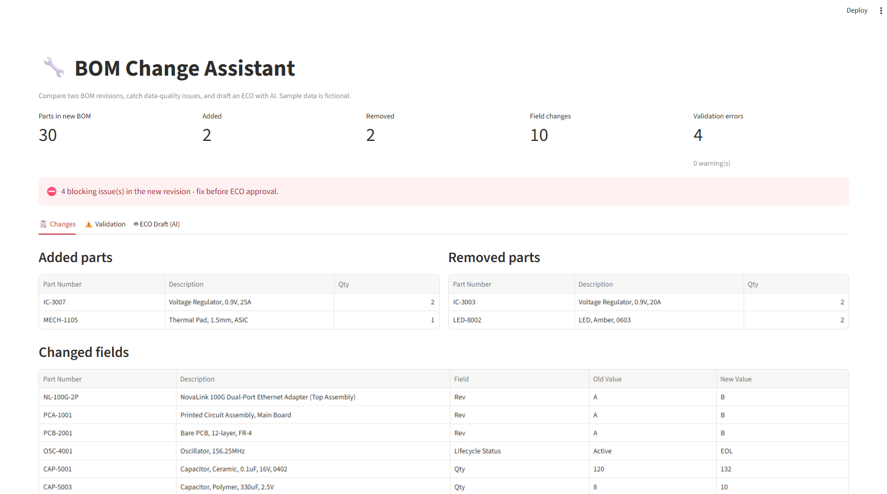
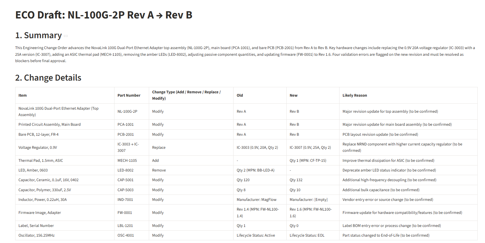

# 🔧 BOM Change Assistant

An AI-assisted tool that compares two revisions of a product **Bill of Materials (BOM)**, catches data-quality issues, and drafts an **Engineering Change Order (ECO)**, cutting the manual work in configuration and change management.

**[▶ Live demo](https://bom-change-assistant.streamlit.app)**



---

## The problem

When a hardware product moves from one revision to the next, someone has to compare the old and new BOMs line by line, find what was added, removed or modified, check the new BOM for errors, and write up the change for approval. Doing this by hand is slow and error-prone: a duplicated line, a missing manufacturer or an end-of-life part can easily slip into production.

## What the tool does

1. **Compares** two BOM revisions (Excel) and lists added parts, removed parts and every changed field (Rev, Qty, Manufacturer, MPN, lifecycle status).
2. **Validates** the new revision with five rules:
   - duplicate part numbers
   - missing required fields
   - invalid quantities (zero, negative, non-numeric)
   - lifecycle status: **EOL** = error, **NRND** = warning
   - orphan parts (parent assembly missing from the BOM)
3. **Drafts an ECO with AI**: summary, change table, affected assemblies, blockers with recommended fixes, risk assessment and an approval checklist.
4. **Shows a dashboard** with key metrics and a downloadable ECO.



## Design decisions

- **Code calculates, AI writes.** The comparison and validation are deterministic Python, so the facts are always exact. The AI (Gemini) only turns those results into a readable document. It is never asked to calculate anything code can calculate.
- **Human in the loop.** The output is a *draft*. Reasons that are not in the data are marked *"(to be confirmed)"*, and validation errors are shown as blockers that must be fixed before approval.
- **Prompt iteration.** Testing revealed two kinds of AI mistakes, and the prompt was improved to prevent them:
  - *Over-generalization*: "LEDs removed" when only one of two LED types was removed. Fixed by giving the model the full parts list and requiring exact part numbers.
  - *Unsupported claims*: stating a quantity was "verified" when the data could not prove it. Fixed by forbidding verification claims that the data does not support.
- **Reliability.** If the AI model is busy (503) or over quota (429), the tool retries and automatically falls back to another model.

## Tech stack

Python · pandas · Streamlit · Google Gemini API · openpyxl

## Project structure

| File | Purpose |
|---|---|
| `bom_compare.py` | Loads BOMs and finds added / removed / changed parts |
| `bom_validate.py` | Data-quality rules for a BOM |
| `eco_generator.py` | Builds the prompt and calls Gemini, with retry and fallback |
| `app.py` | Streamlit dashboard |
| `BOM_NL-100G-2P_RevA.xlsx`, `..._RevB.xlsx` | Fictional sample BOMs |
| `sample_output/ECO_draft_example.md` | Example of a generated ECO |

## Run it locally

```bash
python -m venv venv
venv\Scripts\activate          # Windows  (Mac/Linux: source venv/bin/activate)
pip install -r requirements.txt
```

Create a `.env` file with a free API key from [Google AI Studio](https://aistudio.google.com):

```
GEMINI_API_KEY=your-key
```

Then run:

```bash
streamlit run app.py
```

## About the data

All sample data (the "NovaLink" network adapter, part numbers and manufacturers) is **fictional** and was created for this project.

---

Built by **Vered Simhovich** · [LinkedIn](https://www.linkedin.com/in/veredsimhovich)
